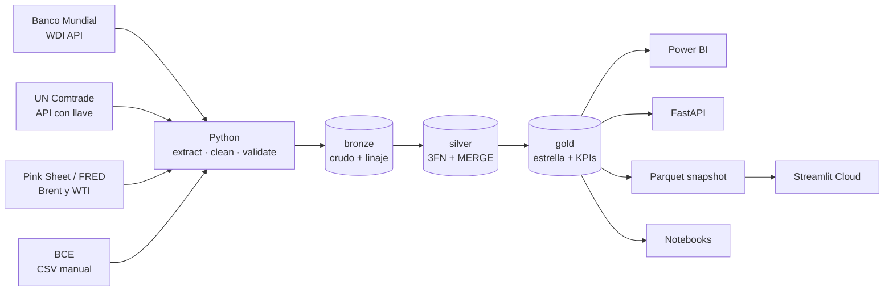

# Plan del proyecto — Ecuador Trade & Economy Monitor

## Pregunta gancho
En los últimos 20 años, ¿Ecuador diversificó de verdad su canasta exportadora o solo cambió el petróleo por el
camarón? ¿Cómo se compara con Perú, Colombia y Chile?

## Preguntas medibles
| # | Pregunta | Eje | Dónde se responde |
|---|---|---|---|
| 1 | ¿Qué % de las exportaciones de Ecuador es petróleo (HS 27) cada año desde 2000? | Dependencia | `vw_oil_dependency`, Q1–Q2 |
| 2 | ¿En qué año cada producto clave superó al petróleo, si ocurrió? | Dependencia | Q4 |
| 3 | ¿Cómo cambió el HHI por producto entre el primer y el último año? | Diversificación | `vw_diversification`, Q7 |
| 4 | ¿El primer producto de la canasta pesa hoy más o menos que el petróleo en 2000? (sustitución vs diversificación) | Diversificación | Q8 |
| 5 | ¿Cuál es el CAGR de camarón, banano, cacao, minería, flores y atún? | Diversificación | `vw_product_cagr`, Q5 |
| 6 | ¿Cuántos destinos "equivalentes" tiene Ecuador y cómo evolucionó? | Diversificación | `vw_diversification` |
| 7 | ¿Cuál es la elasticidad de las exportaciones petroleras y totales al Brent? | Vulnerabilidad | `vw_oil_sensitivity`, Q10 |
| 8 | ¿Cuánto cayeron las exportaciones petroleras y no petroleras en 2009, 2015–16 y 2020? | Vulnerabilidad | Q9 |
| 9 | ¿Cómo crecieron las exportaciones no petroleras de Ecuador frente a PER, COL y CHL (índice 2000 = 100)? | Comparación | `vw_exports_index`, Q12 |
| 10 | ¿Dónde se ubica Ecuador en exportaciones/PIB, crecimiento e inflación frente a la región y LAC? | Comparación | `vw_regional_compare`, Q11 |

## KPIs y fórmulas
| KPI | Fórmula | Unidad |
|---|---|---|
| Exportaciones totales | Σ valor FOB, capítulo `TOTAL`, destino Mundo | USD corrientes |
| % no petrolero | 1 − exportaciones HS 27 / exportaciones totales | % |
| HHI por producto | Σᵢ (100 · Xᵢ / ΣX)², i = capítulos HS2 | 0–10 000 |
| HHI por destino | Σⱼ (100 · Xⱼ / ΣX)², j = países socios (sin áreas especiales) | 0–10 000 |
| Productos equivalentes | 10 000 / HHI | número |
| CAGR por producto | (X_final / X_inicial)^(1/años) − 1 | % anual |
| Elasticidad al Brent | β en ln(X_t) = α + β·ln(Brent_t) + ε_t (años con 12 meses de precio) | adimensional |
| Índice 2000 = 100 | X_t / X_2000 · 100 | índice |

## Arquitectura

## Recorrido de un dato real
Ejemplo: **exportaciones de camarón (HS 0306) de Ecuador hacia el Mundo en 2023**.

1. **API** — `comtradeapicall.getFinalData(..., reporterCode="218", period="2023", cmdCode="TOTAL,0306,...", flowCode="X", partnerCode="0")`.
   La respuesta cruda se guarda en `data/raw/comtrade/218_2023_TOTAL-0306-..._0.json`.
2. **bronze** — `SELECT * FROM bronze.comtrade_raw WHERE reporter_code = 218 AND ref_year = 2023 AND cmd_code = '0306'`:
   la fila llega tal cual (incluye `mot_code`, `customs_code`, `partner2_code`) con su `batch_id`.
3. **Limpieza** — reglas CT01 (solo X), CT02 (solo totales), CT03 (218 → `ECU`), CT04 (valor ≥ 0), CT05 (nivel 4), CT07 (sin duplicados).
4. **silver** — `SELECT * FROM silver.trade_flows WHERE reporter_iso3 = 'ECU' AND [year] = 2023 AND hs_code = '0306' AND partner_code = 0`.
5. **gold** — `fact_trade` con `country_key` de ECU, `product_key` de 0306 y `date_key = 20230101`.
6. **KPI** — `SELECT * FROM gold.vw_export_basket WHERE iso3 = 'ECU' AND [year] = 2023 AND product_group = 'shrimp'`
   devuelve valor, participación y ranking; el mismo número aparece en la página *Canasta* de la app y en Power BI.
